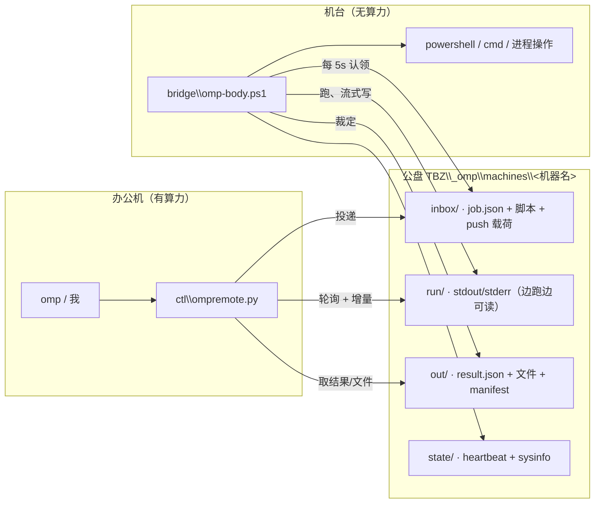

# OMPRemote —— 用公盘（TBZ）远程操控车间上位机

**算力只在办公机。** 车间上位机没有任何模型通路，所以它们不思考，只执行：
机台上跑一个几百行的 `omp-body.ps1`（轮询公盘、跑任务、把 stdout/文件回写），
**agent（omp）留在这台机器上**，靠公盘把"手"伸过去。

公盘是机台与办公机之间唯一可达的通路（其余端口实测不通），所以任务、实时输出、
结果、取消、文件互传全部是文件——天然留痕，断线重连不用重协商，办公机不监听端口。



---

## 能力（就是"操控范围"）

| 命令 | 做什么 |
|---|---|
| `machines` | 哪台机台活着（心跳 / 队列 / 累计任务 / 用户 / 有没有 omp） |
| `ping M` | 机台能力自述：PS、cmd、是否管理员、python/node、omp |
| `run M -e "…"` | 投一段 PowerShell，机台上跑，等输出 |
| `run M -f x.ps1 --cwd D:\Debug --timeout 600` | 投脚本文件（长脚本、中文都安全），指定工作目录 |
| `run M --kind cmd -f x.cmd` | 跑批处理 |
| `fetch M -p "D:\Debug\Log\*.log"` | 把机台上的文件拉回来（sha1 逐个校验，带 manifest） |
| `push M -s tool.exe -d C:\Temp\tool.exe` | 把文件推到机台（落地后 sha1 复核） |
| `tail M <job> --watch` | 实时跟一个任务的输出 |
| `kill M --pid 1234 / --name foo.exe` | 结束机台上的进程（树杀） |
| `cancel M <job>` | 让机台停掉正在跑的任务 |
| `stopall [--off]` | 一键暂停/恢复**所有**机台（公盘上的总开关） |
| `ask M "…"` | 若那台机台**自己**装了 omp 且有模型通路，让它自己干（见"可选升级"） |
| `deploy` / `bootstrap M` | 发布桥到公盘 / 通过 AnchorHub 远程拉起安装 |

认领用 `Move-Item`（同卷 rename 原子）：两台办公机同时投递也不会重复执行。

## 一页上手

```bash
cd E:\Desktop\OMPRemote

python ctl\ompremote.py deploy                  # 发布桥（不需要 omp.exe）
python ctl\ompremote.py bootstrap 7909-217-A     # 远程起桥（前提：该机台的 AnchorHub 锚点在跑）
python ctl\ompremote.py machines

python ctl\ompremote.py run 7909-217-A -e "Get-Process | Where-Object { $_.MainWindowTitle } | Select-Object -First 5 Name,Id"
python ctl\ompremote.py fetch 7909-217-A -p "D:\Debug\Log\*.log" --dest .\pulled\7909
python ctl\ompremote.py push 7909-217-A -s .\collect.ps1 -d "C:\Temp\collect.ps1"
```

没有 AnchorHub 的机台：把公盘 `bundle\install.cmd` 拷过去双击一次（约 1 分钟，不需要
管理员、不需要 omp.exe），之后自启 + 看护。

## 公盘布局

```
TBZ\_omp\
  bundle\                     发布物：omp-body.ps1 / install.ps1 / install.cmd / 现场操作卡.txt
  policy\disabled.txt         总开关（存在 = 所有机台暂停接新任务）
  machines\<MACHINE>\
    inbox\                    <id>.job.json ；files\<id>-x.ps1 ；push\<id>\<文件>
    run\                      <id>.stdout.txt / .stderr.txt（运行中就能读）
    out\                      <id>.result.json / <id>.manifest.tsv / <id>.files\
    state\                    heartbeat.json / sysinfo.json / install.json
```

job 结构（`run/fetch/push/kill/ping` 各有自己的字段）：

```json
{ "ah":1, "id":"20261021-1530-ab12", "kind":"ps|cmd|fetch|push|kill|ping|omp",
  "cwd":"D:\\Debug", "timeout":900, "args":"-X yz",
  "env":{"FOO":"bar"},
  "patterns":["D:\\Debug\\Log\\*.log"], "max_mb":200,
  "target":"C:\\Temp\\tool.exe",
  "pid":1234, "name":"foo.exe" }
```

`run` 的脚本体不塞进 JSON：先落到 `inbox\files\<id>-x.ps1`（**UTF-8 带 BOM**，否则
PS 5.1 会把中文按 ANSI 读，这是 AnchorHub 契约 #85 的实测坑），job 里只引用文件名。

## 现成的机台作业脚本（jobs\）

| 脚本 | 作用 |
|---|---|
| `jobs\rfid-health.ps1` | RFID 读取健康判定：读 `SettingPrm.xml` 里的读写器 IP → 探 LLRP 5084/HTTP 80 → 看谁占着 LLRP 会话 → 看 `EpcLog\<日期>\<日期>.log` 新鲜度 → 数 `Main_<日期>.log` 里的 `Rfid event error`，最后给一行 `VERDICT`（`RFID_OK` / `NO_TAGS` / `READER_BUSY` / `APP_NOT_CONNECTED` / `READER_UNREACHABLE`）。加 `-Inventory` 会用 `Impinj.OctaneSdk.dll` 真做一次盘存，**但发现别的客户端占着会话时拒绝执行**（抢 LLRP 会停线）。 |
| `jobs\probe-multireader-detail.ps1` | 读码器/产线软件画像（进程、IP、D 盘软件清单） |
| `jobs\list-desktop.ps1` | 桌面清单（含 .lnk 目标解析） |
| `jobs\probe-rfid-evidence.ps1` | 采集 RFID 证据：配置、日志、端口、会话、注册表 |

用法：

```bash
python ctl\ompremote.py run <M> -f jobs\rfid-health.ps1 --timeout 180
```

## 边界与风险（说清楚）

1. **机台不思考**：所有判断都在这台机器上完成。要"机台自己想办法"，得让它有模型通路
   （见下）。
2. **`run` 是任意 PowerShell**：这是刻意的——上位机诊断需要能力。代价是公盘上
   `machines\<M>\inbox` 的写权限 = 机台的执行权限。真正的边界在共享目录 ACL；
   要收紧就把 `_omp\machines` 的写权限收给专用账号。总开关 `stopall` 可一键止血。
3. **超时默认 900s**，由机台侧 `taskkill /T /F` 兜底；`cancel` 是同一个动作的温柔版。
4. **延迟**：桥默认每 5 秒扫一次（`-PollSec`），一轮往返 = 5s 量级 + 脚本自身耗时。
   长任务用 `tail --watch` 看实时输出，不要干等。
5. **公盘抖动**：桥每 15 秒重试，不会崩；办公机侧命令会明确报 hub 不可达。
6. **一台机台一个进程**（`bridge.lock` 单实例），启动项 + 计划任务并存也只跑一个。
7. **杀毒**：机台是火绒，首次运行会弹窗，点「允许 + 记住」即可（同批机台在 AnchorHub
   上已验证过同类 exe 的行为）。

## 可选升级：让机台长出自己的 omp

如果某台机台将来能访问模型端点，把 `omp.exe`（约 218MB）放进 `bundle\` 并在机台上
跑一次 `install.ps1`，然后：

```bash
python ctl\ompremote.py ask 7909-217-A "自查一遍镭雕软件的日志，指出异常时间段"
python ctl\ompremote.py ask 7909-217-A -c "把上面那段的上下文贴出来"   # 同一会话续问
```

桥会以 `omp -p … --approval-mode yolo --session-dir <本地>\sessions` 跑，
`-c` 接着同一台机器的上一次会话。**这条路的前提是机台能到模型**；到不了就留在主路径
（我方投脚本、我这边思考）。

## 目录

```
OMPRemote\
  bridge\omp-body.ps1     机台侧执行体（轮询 → 跑任务 → 回写；6 种 kind）
  bridge\install.ps1      安装/升级/自启/自检（-Silent 供远程引导）
  bridge\install.cmd      现场双击入口
  bridge\现场操作卡.txt    一页纸
  ctl\ompremote.py        办公机控制端（machines/ping/run/fetch/push/tail/kill/cancel/stopall/ask/deploy/bootstrap/selftest）
  docs\架构与用法.md       协议细节、状态机、故障排查
```
